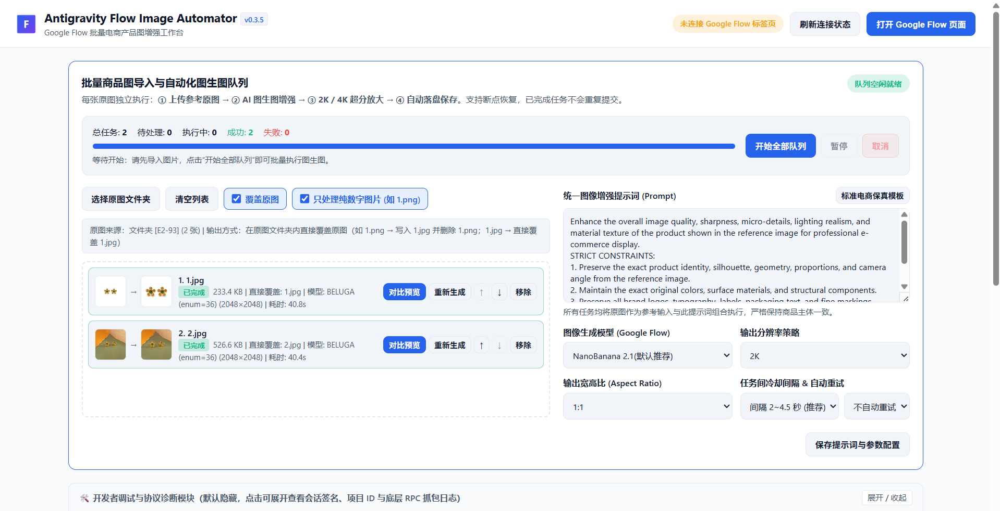
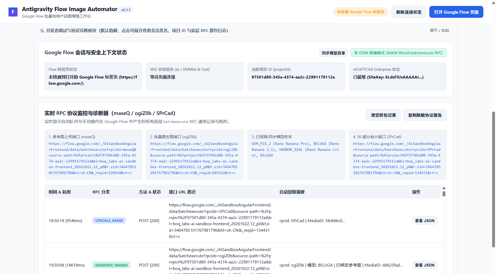

# Antigravity Flow Image Automator

**Antigravity Flow Image Automator** 是一款基于 Chrome Manifest V3 的批量商品图 AI 精修自动化工作台插件，专为 **Google Flow (`https://flow.google.com`)** 打造。

不同于传统的模拟点击（DOM 选择器点击/按键脚本），本扩展采用**纯协议层 `batchexecute` RPC 驱动引擎**，直接在页面上下文中完成参考图上传（`maseQ`）、图生图生成（`ogiZ0b`）、以及 2K 超清放大（`SPrCad`），具备高稳定性、不受页面 UI 改版影响、支持多层文件夹原位覆盖等特性。

---

## ✨ 核心特性

### 1. 纯协议层自动化（零 DOM 点击模拟）
- **原厂级模型锁定**：默认锁定 **NanoBanana 2.1 (`BELUGA` / `enum = 36`)**，同时支持切换 **NanoBanana Pro (`GEM_PIX_2`)** 与 **NanoBanana 2 Lite (`HARBOR_SEAL`)**，绝不因参数回退而降级模型。
- **全链路 RPC 驱动**：自动执行 `上传参考原图 -> 提交图生图请求 -> 2K 超清放大 -> 下载并写入本地磁盘`。
- **双通道防检测保护**：内置针对 Google Flow `x2a` 扩展环境校验的 `document_start` 原生捕获与 `Object.assign` 还原机制，确保 `IMAGE_GENERATION` 令牌签名稳定通过。

### 2. 严格互斥的双导入模式与文件夹暂存扫描
- **导入方式严格限定（下拉选项互斥）**：
  - **导入文件夹模式**：
    - 导入后**不立即扫描文件**，而是生成直观的“文件夹卡片图标”；
    - 支持**逐次追加拖拽/选择单个文件夹**，或**一次拖拽多个文件夹**；
    - 区域右下角提供 **“确定扫描”** 按钮（仅在有待扫描文件夹时高亮可点，无文件夹时自动置灰）；
    - 点击“确定扫描”后实时显示扫描进度条，解析全部文件夹中的图片；
    - **扫描成功后自动切换为“图片任务列表”，并严格锁定**：不可再次导入文件夹，不可导入单个/多个图片，下拉选项禁用锁定，防止队列污染。如需重新导入，点击“清空列表”即可解锁复位。
  - **导入图片模式**：
    - 直接接收单张或多张图片的拖拽、文件选择与剪贴板 `Ctrl+V` 粘贴；
    - 导入后立即生成图片任务列表，互斥锁定导入方式。
- **只处理纯数字图片（默认勾选）**：
  - 勾选 `只处理纯数字图片 (如 1.png)` 后，自动过滤掉包含字母、符号或后缀（如 `banner.jpg`、`1_detail.png`、`logo.webp`）的文件，仅将主文件名为纯数字（如 `1.png`、`4.jpg`、`12.webp`）的商品主图加入队列。

### 3. 原位覆盖原图 vs. 保留原图双模式
- **覆盖原图模式（默认勾选 `覆盖原图`）**：
  - 无需额外配置“输出文件夹”。当使用“选择原图文件夹”或“拖入文件夹”扫描出多级子目录图片时，每成功生成一张图片，直接写回该图片原本所在的子文件夹：
    - 若原图是 `4.png`，Google Flow 返回 `.jpg`：自动在同一子目录下写入新的 `4.jpg`，并自动删除原 `4.png`。
    - 若原图是 `4.jpg`，Google Flow 返回 `.jpg`：直接在同一子目录下覆盖更新 `4.jpg`。
- **非覆盖模式（取消勾选 `覆盖原图`）**：
  - 同样直接保存在原图所在的子目录下，但不会删除原图，而是以带后缀的新文件名保存（例如原图为 `4.png`，保留 `4.png` 并新增 `4_enhanced_2K.jpg`）。
- **指定统一输出文件夹（可选）**：
  - 如果主动选择了“输出文件夹”，也可将所有生成结果按原有子目录结构输出到指定目录。

### 4. 全屏双栏对比预览 & 实时跨栏区域同步
- 点击任务行右侧的 **“对比预览”**，弹出 **`97vw × 95vh` 全屏级左右分栏对比窗口**：
  - **鼠标滚轮无级缩放（`50% ~ 800%`）**：以鼠标指针所在位置为中心点精准放大/缩小细节。
  - **按住鼠标左键自由拖拽平移**：查看高分辨率商品边缘、材质与光影细节。
  - **一键 `100% 重置`**：左右两侧左上角均配备 `100% 重置` 按钮。
  - **实时“显示区域同步”（默认双向开启）**：
    - 左右两侧顶部均配备 **`显示区域同步`** 勾选框（**默认双侧均勾选**）；
    - 无论是缩放或拖拽左侧原图，还是右侧增强图，另一侧图片都会**实时 1:1 双向同步跟随移动和无级缩放**，开箱即可逐像素比对精修前后细节差异。也可以按需单独取消单侧或双侧同步以进行独立平移。

### 5. 任务完成恭喜弹窗与耗时统计
- 当批量队列全部执行完毕时，自动弹出 **任务完成统计弹窗**：
  1. **处理结果统计**：`恭喜成功处理 X 张图片，失败了 X 张`
  2. **总共耗时**：自动格式化为中文时长（如 `1小时2分20秒`、`3分10秒` 或 `55秒`）
  3. **平均单个图片耗时**：自动计算单张图片平均耗时（如 `3分10秒` 或 `55秒`）

### 6. 关键操作行为记录 & 队列进行中实时计时器
- **关键操作行为记录面板**：
  - 在状态提示行左侧设有 **`📋 行为记录`** 小按钮，带实时操作计数小红点；
  - 自动全量捕获并结构化归档：**导入文件夹/图片、添加待扫描项、开始扫描、完成扫描、启动队列、处理阶段（上传/生图/超分）、完成单图、单图失败、暂停/继续/取消、清空列表** 等全流程核心行为，单图日志全面展示**“带顶级文件夹的相对完整路径”**（如 `[E1-004/2.png]`）；
  - 弹窗面板支持**一键复制全部纯文本记录**与**一键清空记录**。
- **“开始全部队列”上方实时计时器**：
  - 队列运行期间，按钮上方实时展示已执行时间（如：`任务已进行 1小时15分19秒`、`任务已进行 45分19秒`、`任务已进行 49秒`）；
  - 支持暂停保持、恢复续跑累加与完成定格。

### 7. 屏幕分辨率自适应与界面缩放 (适合 2K / 4K / 超宽大屏)
- **流式弹性布局，告别大屏两侧大面积空白**：
  - 取消传统固定的 `1360px` 窄屏限制，采用 `width: 96%; max-width: 1880px`（超宽/4K 屏可达 `2360px`）；
  - 针对高分辨率屏幕（`min-height: 900px / 1100px`）自适应扩充任务列表高度（最高扩展至 `720px`），大幅增加同屏可见的任务行数与图片详情。
- **顶部智能界面缩放调节**：
  - 顶部导航栏提供 **`🖥️ 界面缩放`** 下拉菜单，支持 `自动检测 (最佳适配)`、`100% 标准`、`110% 适中`、`120% 放大`、`135% 超大`；
  - **自动检测模式**：根据系统屏幕物理分辨率与 DPR 自动适配（2K/4K 自动放大至 120%，1080p 适配 108%，笔记本保持 100%），字体清晰饱满、排版舒展；
  - 缩放配置通过 `chrome.storage.local` 自动持久化保存，下次打开自动复用。

---

## 📦 安装指南

1. 打开 Chrome 浏览器，在地址栏输入并访问：
   ```text
   chrome://extensions/
   ```
2. 打开右上角的 **“开发者模式 (Developer mode)”** 开关。
3. 点击左上角的 **“加载已解压的扩展程序 (Load unpacked)”**。
4. 选择本项目根目录：
   ```text
   d:\MyProject_Web2\AIAgentProjects\Antigravity-Flow-Image-Automator
   ```
5. 安装完成后，固定（Pin）浏览器右上角工具栏中的 **Antigravity Flow Image Automator** 图标。

---

## 🚀 快速使用流程

### 第一步：打开 Google Flow 项目页
1. 在 Chrome 中打开 [Google Flow](https://flow.google.com/) 并登录账号。
2. 进入任意一个 Flow 项目页面（URL 形如 `https://flow.google.com/project/{projectId}`）。
3. **重要提示**：首次安装或更新插件后，请按 **`F5` 刷新一次** 该 Google Flow 页面，以确保协议桥接脚本注入生效。

### 第二步：打开自动化工作台并配置参数
1. 点击浏览器右上角插件图标，打开 **Antigravity Flow Image Automator 工作台**。
2. 确认顶部状态栏显示绿色 **“已连接 Google Flow 页面”**。
3. 在 **“1. 批量参数与提示词配置”** 中确认参数：
   - **AI 模型**：默认推荐 `NanoBanana 2.1(默认推荐)`
   - **输出分辨率**：默认 `2K (自动触发高清放大)`
   - **画面比例**：默认 `1:1 (正方形 1024×1024)`（支持 `16:9`、`4:3`、`1:1`、`3:4`、`9:16`）
   - **任务冷却间隔**：默认 `3~5秒`（支持 `3~5秒`、`10~20秒`、`20~30秒`、`30~40秒`）
   - **失败自动重试**：默认 `不自动重试`（可根据需要开启 1~2 次重试）

### 第三步：导入商品原图并启动队列
1. 在 **“2. 批量图片队列执行器”** 中确认顶部的两个勾选项：
   - `[✓] 覆盖原图`（默认勾选：精修图直接替换原图；取消勾选则保留原图并生成 `_enhanced_2K` 副本）
   - `[✓] 只处理纯数字图片 (如 1.png)`（默认勾选：仅导入 `1.png`、`2.jpg` 等纯数字命名图片）
2. 点击 **“选择原图文件夹”**（或直接把文件夹/图片拖入虚线框），浏览器弹出“允许查看和编辑文件”权限提示时，点击 **“查看文件 / 允许保存更改”**。
3. 点击绿色按钮 **“开始队列”**。
4. 队列运行过程中可随时查看每张图片的实时阶段（上传参考图 -> 图生图生成 -> 2K 超清放大 -> 写入本地文件），也可对任意已完成图片点击 **“对比预览”** 全屏验图。
5. 全部处理完成后，系统将弹出 **“任务列表处理完成”** 恭喜提示框，汇报成功/失败张数、总耗时与平均单图耗时。

---

## 💡 操作者建议：任务进行时，需要完全放弃电脑操作吗？

**不需要放弃电脑操作！您可以在队列运行期间正常使用电脑处理其他工作。**

### 为什么可以继续用电脑？
本插件采用的是 **底层 HTTP RPC 协议直连通信**，而不是控制鼠标指针或模拟键盘点击网页按钮。所有的图片读取、接口请求、轮询放大、以及文件落盘都在浏览器后台与扩展工作台中静默完成，**不会抢占您的鼠标焦点或键盘输入**。

### 队列运行期间的 4 条最佳实践建议：
1. **可以自由使用其他软件和浏览器标签页**：
   - 您可以正常切到微信、钉钉、Excel、Photoshop、VS Code 或在浏览器里新建其他标签页浏览网页、看视频，完全不会干扰图片生成队列。
2. **不要关闭或最小化包含 Google Flow 的那个浏览器窗口（可置于后台遮挡）**：
   - 请保持 **Google Flow 项目标签页** 和 **插件工作台标签页** 处于打开状态。
   - **建议**：不要点击浏览器右上角的“最小化（`_`）”按钮把整个 Chrome 窗口缩到任务栏（因为 Chrome 会对最小化窗口启用重度后台定时器节流），而是直接把其他软件窗口叠放在 Chrome 上方即可。
3. **不要在正在跑队列的同一个 Google Flow 标签页里手动点生成**：
   - 队列运行期间，避免切回那个正在被插件调用的 Google Flow 标签页里手动点击生成或频繁刷新页面，以免触发单会话并发冲突。
4. **长时间大批量任务请关闭系统自动休眠**：
   - 如果一次处理上百张图片（耗时超过 30 分钟），请确保电脑已连接电源，并在 Windows 电源设置中将“睡眠”设为“从不”，防止电脑锁屏休眠导致网络中断。

---

## 🗂️ 项目目录结构

```text
Antigravity-Flow-Image-Automator/
├── manifest.json                 # Chrome MV3 扩展清单 (v0.3.13)
├── README.md                     # 项目完整说明文档
├── background/
│   └── service-worker.js         # MV3 后台服务工作线程（连接管理、标签页调度与协议日志持久化）
├── content/
│   ├── main-api-bridge.js        # MAIN World 核心协议引擎（document_start 注入、x2a 防护、batchexecute RPC 管线）
│   └── isolated-relay.js         # ISOLATED World 安全消息中继桥
├── workbench/
│   ├── workbench.html            # 批量自动化工作台主界面（含全屏对比弹窗与完成统计弹窗）
│   ├── workbench.css             # 工作台深色主题样式与响应式布局
│   └── workbench.js              # 队列状态机、IndexedDB 断点续传、File System Access 原位覆盖与同步预览交互
└── icons/                        # 扩展图标资源 (16x16 / 48x48 / 128x128)
```

### 界面
- 
- 